<h1 align="center">forge</h1>

<p align="center">
<b>The data layer for robot learning.</b><br>
Convert any robotics dataset format, score every episode, and curate a corpus you can query, search and train on.
</p>

<p align="center">
<a href="https://pypi.org/project/forge-robotics/"></a>
<a href="https://colab.research.google.com/github/arpitg1304/forge/blob/main/notebooks/forge_quickstart.ipynb"></a>
<a href="https://arpitg1304.github.io/forge/"></a>

<a href="LICENSE"></a>
</p>

<p align="center">

</p>

Robot learning runs on data that arrives in a dozen formats, at the wrong frame rate, with idle starts, frozen cameras and gripper chatter that nobody notices until a policy learns them. Forge is the layer between the robot and the trainer:

- **A format toolkit.** Inspect, convert, score, lint, filter, segment, tokenize and visualize one dataset, across every major robotics format.
- **A data engine.** Register every episode into an append-only **catalog**, then query it with SQL, search it in natural language, dedup and curate it, and review it in **Studio**.

Every command works on local paths, `hf://` datasets, registry ids and `s3://` / `gs://` buckets.

<p align="center">
<a href="#install">Install</a> ·
<a href="#convert">Convert</a> ·
<a href="#score-and-clean">Quality</a> ·
<a href="#understand">Segment &amp; tokenize</a> ·
<a href="#the-data-engine">Data engine</a> ·
<a href="#supported-formats">Formats</a> ·
<a href="#known-limitations">Limitations</a> ·
<a href="#roadmap">Roadmap</a>
</p>

---

## Install

```bash
pip install forge-robotics                  # CLI + LeRobot v3 read/write
pip install "forge-robotics[all]"           # everything
```

<details>
<summary><b>Pick only the extras you need</b></summary>

| Extra | Adds | Extra | Adds |
|---|---|---|---|
| `[rlds]` | RLDS / Open-X (TensorFlow) | `[s3]` | Read from Amazon S3 |
| `[lerobot]` | LeRobot v2/v3 (Parquet) | `[gcs]` | Read from Google Cloud Storage |
| `[mcap]` | MCAP (ROS 2 + Foxglove) | `[catalog]` | The catalog (DuckDB) |
| `[hdf5]` | HDF5 (ALOHA, robomimic) | `[embed]` | Semantic search (SigLIP) |
| `[zarr]` | Zarr (Diffusion Policy, UMI) | `[video]` | Video decoding, video quality, Studio thumbnails |
| `[rosbag]` | ROS 1 / ROS 2 bags | `[rerun]` | Rerun viewer |

**RoboDM** (`.vla`, up to 70× compression) needs a manual install because the PyPI build has a codec bug:

```bash
git clone https://github.com/BerkeleyAutomation/robodm.git && pip install -e robodm
```
</details>

> [!NOTE]
> The PyPI release is the stable **format toolkit**. The **data engine** (catalog, semantic search, dedup, curation and Studio) is newer than the last release. To use it today, install from source:
> ```bash
> git clone https://github.com/arpitg1304/forge.git && cd forge && pip install -e ".[all]"
> ```

## Try it in 60 seconds

[](https://colab.research.google.com/github/arpitg1304/forge/blob/main/notebooks/forge_quickstart.ipynb) Pick a public LeRobot dataset, score every episode and drill into the worst demos. No GPU, no auth.

```bash
forge inspect hf://lerobot/pusht                            # what's in it?
forge quality hf://lerobot/pusht --fps 10                   # score every episode
forge convert hf://lerobot/pusht ./out --format lerobot-v3  # convert it
```

Forge is hub-and-spoke: **any reader → `Episode` / `Frame` → any writer**. Add a reader and every writer works with it, with no N×M conversion code. See [docs/architecture.md](docs/architecture.md).

---

# The format toolkit

One dataset at a time. Every command takes a local path, a registry id (`droid`), an `hf://` URL or an `s3://` / `gs://` URI.

## Convert

```bash
forge inspect ./dataset                                    # structure, schema, cameras, fps
forge convert ./rlds_dataset ./out --format lerobot-v3     # convert between formats
forge convert ./data.zarr ./out --format lerobot-v3 --fps 10 --visualize
```

| You have | You want | One command |
|---|---|---|
| MCAP from ROS 2 / teleop | LeRobot v3 for Hugging Face | `forge convert teleop.mcap ./out --format lerobot-v3` |
| RLDS from Open-X | LeRobot for fine-tuning | `forge convert hf://openvla/modified_libero_rlds ./out -f lerobot-v3` |
| HDF5 from ALOHA / robomimic | MCAP for Foxglove playback | `forge convert aloha.hdf5 ./out --format mcap` |
| Zarr from Diffusion Policy | LeRobot v3 | `forge convert pusht.zarr ./out --format lerobot-v3` |

For complex conversions, generate a YAML config with `forge inspect ds/ --generate-config config.yaml`, then run `forge convert ds/ out/ --config config.yaml`. See [docs/configuration.md](docs/configuration.md), and note which config keys are applied today under [Known limitations](#known-limitations).

## Score and clean

<p align="center">

</p>

**Quality** scores every episode from proprioception, and optionally from video. The 0–10 score is a heuristic; episodes that can't be scored stay `null`. Every flag is a review candidate, not a failure label.

```bash
forge quality ./my_dataset --fps 10 --gripper-dims 6 --export quality.json --visualize
forge quality ./my_dataset --video --video-level motion       # needs [video]
```

- **Motion:** held commands, measured-motion pauses, direction reversals, smoothness (LDLJ), action entropy, path length.
- **Timing:** timestamp gaps and jitter.
- **Gripper:** chatter on the channels you name. Physical action limits are set explicitly.
- **Tracking:** stall candidates from known absolute-position action/state pairs (`--tracking-pairs`).
- **Video:** camera coverage, decode failures, blur, exposure, frozen frames and estimated observation gaps.

Details: [quality](forge/quality/README.md) · [video quality](forge/quality/video/README.md) · [viewer](forge/visualize/README.md) · [validation and benchmarks](docs/reports/README.md).

**Lint** checks dataset hygiene against Hugging Face's LeRobot guidelines: missing task strings, ambiguous cameras, low resolution, single view, missing action fields. It exits non-zero, so it drops into CI.

```bash
forge lint ./my_dataset --strict
```

**Filter** drops episodes by score, flags or ids, and writes a new dataset. Pass the report you reviewed so filtering uses the same scores:

```bash
forge filter ./my_dataset ./clean --from-report quality.json --min-quality 6.0 \
    --exclude-flags jerky,mostly_static,gripper_chatter
```

**Dedup** removes near-duplicate episodes within one dataset by perceptual hashing of keyframes (numpy only, no model).

```bash
forge dedup ./my_dataset ./deduped --threshold 0.05
```

Details: [lint](forge/lint/README.md) · [filter](forge/filter/README.md) · [dedup](forge/dedup/README.md).

## Understand

**Segment** splits episodes into phases (reach, grasp, place) with PELT changepoint detection on proprioception.

```bash
forge segment hf://lerobot/droid_100 --export segments.json --plot timeline.png
```

**Tokenize** turns continuous actions into discrete tokens for VLA training, and benchmarks strategies on *your* data. Built-ins: `uniform-bins` (RT-1), `openvla-bins`, `quantile-bins`, `mu-law`.

```bash
forge tokenize compare ./my_dataset --sample 20            # reconstruction error, vocab use
forge tokenize write ./my_dataset ./tokenized --strategy openvla-bins
```

**Visualize** in the browser (default, no install), matplotlib, OpenCV or [Rerun](https://rerun.io) (cameras and time series on one timeline).

```bash
forge visualize pusht
forge visualize pusht --backend rerun --segment
```


Details: [segment](forge/segment/README.md) · [tokenize](forge/tokenize/README.md).

---

# The data engine

<p align="center">

</p>

The toolkit works on one dataset. The **catalog** makes forge a system of record: append-only Parquet tables that register every episode you ingest and annotate it with quality, embeddings and curation decisions, all queryable with SQL. There is no server (Parquet plus embedded DuckDB), it lives in a local directory or an `s3://` / `gs://` bucket, and pandas, Polars or Spark can read it without forge.

```bash
pip install "forge-robotics[catalog]"       # + [embed] for search, [video] for Studio thumbnails
```

### 1. Ingest and query

```bash
forge catalog init ./forge-catalog                                 # local dir or cloud bucket
forge ingest ./my_dataset -c ./forge-catalog                       # register + score each episode
forge ingest s3://lab-bucket/raw/2026-07-18/ -c ./forge-catalog    # re-runs are a no-op (content hash)

forge query "SELECT task, count(*) FROM episodes GROUP BY task" -c ./forge-catalog
forge catalog stats -c ./forge-catalog
```

Ingest reuses the readers behind `forge inspect` and the scorer behind `forge quality`, so the catalog agrees with the toolkit. Views: `episodes`, `quality_scores`, `v_latest_quality`, `v_curation`.

```python
from forge.catalog import Catalog
from forge.catalog.ingest import ingest

cat = Catalog.init("s3://lab-bucket/forge-catalog")
ingest(["s3://lab-bucket/raw/2026-07-18/"], cat)
df = cat.sql("SELECT robot, avg(overall_score) FROM episodes "
             "JOIN v_latest_quality USING(episode_id) GROUP BY robot").to_pandas()
```

### 2. Search in natural language

Embed episodes with [SigLIP](https://huggingface.co/google/siglip-so400m-patch14-384), a shared image–text model, so text queries match what happens in the *video*, not just the metadata.

```bash
forge embed -c ./forge-catalog                             # CUDA → Apple MPS → CPU
forge search "picks up the red cup" -c ./forge-catalog --top 10
forge search --like <episode_id> -c ./forge-catalog        # visually similar episodes
```

Vectors are versioned per model (`siglip-so400m@<ckpt-hash>`). Details: [forge/embed/README.md](forge/embed/README.md).

### 3. Dedup and curate

Near-duplicate pairs across the whole corpus are stored as **facts**; which episode wins is a **policy** applied at curation time. Curation is an append log (latest label wins), so nothing is ever deleted.

```bash
forge catalog dedup -c ./forge-catalog --threshold 0.97

forge curate -c ./forge-catalog \
    --where "overall_score > 6 AND task = 'pick_place'" \
    --dedup 0.97 --dedup-policy keep-higher-quality --label approved

forge search "regrasp after a failed pick" -c ./forge-catalog --top 20 --save sel.json
forge curate -c ./forge-catalog --from sel.json --label approved
```

Policies: `keep-higher-quality`, `keep-longer`, `keep-first`.

### 4. Studio

One self-contained HTML file to explore the catalog: overview, corpus (thumbnails and quality rings), dedup review (keep or reject pairs) and snapshot. No server; share it like any file.

```bash
forge studio -c ./forge-catalog -o studio.html && open studio.html
```

Storage layout and commit protocol: [forge/catalog/README.md](forge/catalog/README.md). An [example catalog](forge/catalog/catalog_example_droid_100/) built from droid_100 ships in the repo.

---

# Reference

## Supported formats

| Format | Read | Write | Notes |
|---|:-:|:-:|---|
| LeRobot v3 | ✓ | ✓ | Hugging Face, Parquet + MP4 |
| LeRobot v2 | ✓ | – | Read only; convert to v3 to write |
| RLDS | ✓ | ✓ | Open-X, TensorFlow Datasets |
| MCAP | ✓ | ✓ | ROS 2 CDR + Foxglove Protobuf, no ROS install needed |
| RoboDM | ✓ | ✓ | Berkeley `.vla` (manual install) |
| GR00T | ✓ | – | NVIDIA Isaac, LeRobot v2 + embodiment metadata |
| HDF5 | ✓ | – | robomimic, ACT / ALOHA |
| Zarr | ✓ | – | Diffusion Policy, UMI |
| Rosbag | ✓ | – | ROS 1 `.bag`, ROS 2 SQLite3 (images only today, see below) |

Which models use which format: [docs/model_formats.md](docs/model_formats.md). Format specs: [docs/format_reference.md](docs/format_reference.md).

## Cloud storage

Any dataset or catalog path can be an `s3://` or `gs://` URI. Auth uses each provider's standard credential chain; forge never handles credentials.

```bash
pip install "forge-robotics[s3]"            # or [gcs]
forge inspect s3://my-bucket/datasets/run_0413
forge convert gs://lab-data/rosbags ./out --format lerobot-v3
```

For **LeRobot v3** and **Zarr**, `inspect` and `ingest` stream with range requests instead of downloading. Inspecting a 464 MB cloud dataset fetches about 3 KB; ingesting it reads only the proprio columns (about 3 MB), never the videos. Other formats are downloaded to a temp dir and cleaned up. Conversion outputs are local only for now. Guide: [forge/io/README.md](forge/io/README.md).

## Dataset registry

23+ well-known robotics datasets, usable by name. **[Browse online](https://arpitg1304.github.io/forge/registry.html)**

```bash
forge registry list --format rlds --embodiment franka
forge registry search "franka manipulation"
forge inspect droid                                        # ids work in any command
forge demo                                                 # download, inspect and score a demo
```

To add a dataset, see [forge/registry/CONTRIBUTING.md](forge/registry/CONTRIBUTING.md).

## Commands

| | |
|---|---|
| **Toolkit** | `inspect` · `convert` · `quality` · `lint` · `filter` · `dedup` · `segment` · `tokenize` · `visualize` · `stats` · `export-video` |
| **Data engine** | `catalog init` · `ingest` · `query` · `catalog stats` · `embed` · `search` · `catalog dedup` · `curate` · `studio` |
| **Discovery** | `hub` · `local` · `registry` · `demo` · `formats` · `version` |

Full reference: [docs/cli.md](docs/cli.md), or `forge <command> --help`.

## Known limitations

Forge is honest about what it does not do yet. These are tracked and being fixed:

- **Rosbag** conversion reads image topics only and yields the whole bag as one episode; state and action are not filled yet, even though `inspect` lists those topics.
- **YAML conversion configs** apply `writer_config:` and `cameras:` only. `fields:`, `video:`, `include_depth` and `transform` are parsed but not applied yet.
- **LeRobot v3 writer** writes `names: null` for features, uses the task `"default"` when an episode has no language instruction, and creates one chunk per episode.
- **`--sample` and `--quick`** take the *first* N episodes, not a random subset.
- **`filter` without `--from-report`** re-scores with a reduced config (gripper dims, FPS, bounds only). Pass `--from-report` to filter on the scores you reviewed.
- **Zarr** has no FPS metadata, so it defaults to 30 Hz. Pass `--fps` (Push-T is 10 Hz).
- **`--visualize`** blocks until Ctrl+C, so avoid it in scripts.
- **RLDS:** episode-level language only (Open-X often stores it per step), and the writer emits flat `tf.train.Example` records rather than nested RLDS.
- **LeRobot v2 videos:** a frame that can't be decoded is replaced by a black frame, now with a warning in the log.

## Roadmap

- [x] Format toolkit: convert, inspect, quality, lint, filter, dedup, segment, tokenize, visualize
- [x] MCAP read + write without a ROS install · cloud storage on every command · dataset registry
- [x] The catalog: ingest, SQL, semantic search, dedup, curation, Studio
- [~] Streaming reads: LeRobot v3 and Zarr metadata + proprio today; frames and embeddings next
- [ ] Close the gaps above, starting with rosbag state/action and YAML field mappings
- [ ] Trim idle starts and ends on write (`convert --trim-idle`)
- [ ] q01 / q99 quantiles in LeRobot v3 `stats.json` (needed by π0.5-style training)
- [ ] Train / val / test split by episode or session
- [ ] Snapshots + export: a curated catalog selection → LeRobot / RLDS for training
- [ ] `forge push` to the Hugging Face Hub
- [ ] Episode-length outliers, failed-take detection, action-to-state lag, camera drift
- [ ] Depth and point clouds · GR00T writer · distributed conversion

## Development

```bash
make venv && source .venv/bin/activate
make install-dev
make test
```

Contributions welcome. Start with [docs/architecture.md](docs/architecture.md).

## License

MIT
